# pipboy-3000-cyd-display

A **Fallout-style Pip-Boy** firmware for the **ESP32-2432S028R "Cheap
Yellow Display"** (CYD) — a $13 board with a 2.8" ILI9341 touchscreen.
Boots into a green-phosphor Vault-Tec UI with tabbed **STAT / INV / DATA /
MAP / RADIO** screens, an apps drawer, and — the fun part — a self-forming
**ESP-NOW mesh** so multiple PIP-BOYs in a room find each other, chat,
play **multiplayer blackjack**, and locate one another on a wasteland map
by radio signal strength.

No internet required for any of the mesh features — the devices talk
directly to each other over ESP-NOW. WiFi is optional (weather, NTP, a
chat bridge).

<table>
  <tr>
    <td align="center" width="50%">
      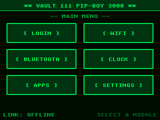<br>
      <sub><b>boot menu</b> — login, wifi, bluetooth, clock, apps, settings</sub>
    </td>
    <td align="center" width="50%">
      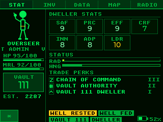<br>
      <sub><b>STAT</b> — pick a Vault dweller, track your vitals</sub>
    </td>
  </tr>
</table>

> **Unofficial fan project. Not affiliated with, endorsed by, or sponsored
> by Bethesda Softworks or ZeniMax Media.** "Fallout", "Pip-Boy", and
> "Vault-Tec" are trademarks of their respective owners, used here
> nominatively to describe the aesthetic. Firmware is MIT-licensed (see
> [`LICENSE`](LICENSE)); the look-and-feel references are not.

---

## Hardware

| | |
| --- | --- |
| **Board** | ESP32-2432S028R (CYD, USB-C variant) — ESP32-WROOM, 4 MB flash, no PSRAM |
| **Display** | 2.8" ILI9341 320×240 LCD (landscape), driven by TFT_eSPI + LVGL 8.3 |
| **Touch** | XPT2046 resistive panel — 4-corner calibration, persisted to NVS |
| **Audio** | Speaker via LEDC PWM tone driver (non-blocking SFX) |
| **Radio** | ESP-NOW mesh (no AP needed) + optional 2.4 GHz WiFi; NimBLE for the BLE thermometer |
| **Storage** | NVS for login, custom name, calibration, anchor mode, settings |

Same board as the
[claude-desktop-buddy-cyd](https://github.com/jdperich/claude-desktop-buddy-cyd)
project — if you have one of those, this flashes onto it directly.

---

## What it does

### Vault dweller UI

Log in as one of a dozen **Vault-Tec dweller archetypes** (Overseer,
Wanderer, Ranger, Mechanist, …) — or type your own name on the on-screen
keyboard (saved to flash). The five-tab interface mirrors the in-game
Pip-Boy:

- **STAT** — your dweller, aptitude scores, perks, HP/rad/morale
- **INV** — tools, provisions, and holotapes with condition + bonuses
- **DATA** — a wasteland quest log
- **MAP** — a stylized overworld with a sweeping **RADAR** overlay
- **RADIO** — live mesh peers with signal bars + group/DM chat

<table>
  <tr>
    <td align="center" width="25%">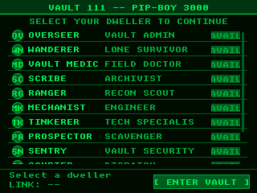<br><sub><b>login</b> — pick a dweller</sub></td>
    <td align="center" width="25%">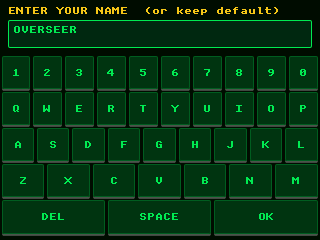<br><sub><b>name entry</b> — or type your own</sub></td>
    <td align="center" width="25%">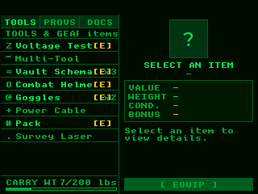<br><sub><b>INV</b> — inventory</sub></td>
    <td align="center" width="25%">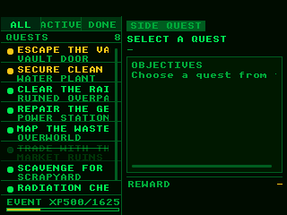<br><sub><b>DATA</b> — quests</sub></td>
  </tr>
</table>

### ESP-NOW mesh — the good part

Every PIP-BOY broadcasts a heartbeat over ESP-NOW and builds a live peer
list with no router, no pairing, no setup. Channel-hopping (1/6/11) lets
devices find each other, and a gateway-election step lets one WiFi-connected
device share time/weather with the offline ones.

- **Mesh chat** — group + direct messages, with store-and-forward sync so a
  device that joins late can pull history
- **Multiplayer Blackjack** — host-authoritative, up to 6 seats, chips +
  betting + a running "top winner", all over ESP-NOW
- **Presence / status** broadcast (active / away / busy / DND)

<table>
  <tr>
    <td align="center" width="33%">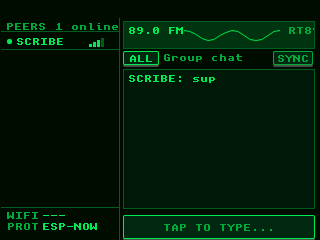<br><sub><b>RADIO</b><br>peers + chat</sub></td>
    <td align="center" width="33%">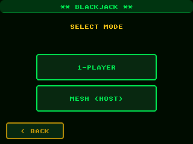<br><sub><b>blackjack</b><br>1P or mesh</sub></td>
    <td align="center" width="33%"><br><sub><b>mesh table</b><br>up to 6 seats</sub></td>
  </tr>
</table>

### Radio positioning (RSSI multilateration)

The MAP's RADAR adapts to how many devices are around:

- **alone** → a DEMO mode animates simulated contacts
- **a couple peers** → a DISTANCE readout estimates range from signal strength
- **3+ devices with ≥2 anchors** → real positions plotted by **weighted-centroid
  multilateration**

Flip a device into **anchor mode** (Settings → Anchor / Location) and place
it at a known landmark; roaming PIP-BOYs then estimate their own (x, y) from
the anchors' signal strengths and broadcast it, so everyone sees everyone on
the wasteland map. Bearing is a stable per-device angle (a single antenna
can't sense direction); distance is RSSI-derived and smoothed. Coarse and
drifty by nature — good for "she's over by the diner," not survey-grade.

<table>
  <tr>
    <td align="center" width="33%">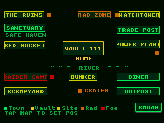<br><sub><b>MAP</b><br>wasteland overworld</sub></td>
    <td align="center" width="33%">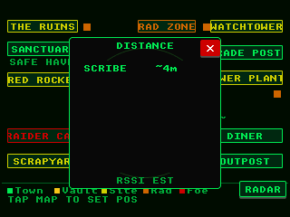<br><sub><b>RADAR</b><br>RSSI proximity</sub></td>
    <td align="center" width="33%">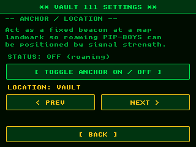<br><sub><b>anchor mode</b><br>pin to a landmark</sub></td>
  </tr>
</table>

### Apps drawer

`POMODORO · STOPWATCH · PING · STATUS · SOUNDBOARD · HOLOTAPE · DICE ·
BLACKJACK · SNAKE · RAD STATS · PAGER · QUESTS · CALIBRATE`

Plus a **BLE temperature probe** (NimBLE, ThermoPro-compatible) for reading a
wireless thermometer, a weather widget, and an NTP/mesh-synced clock.

<table>
  <tr>
    <td align="center" width="33%">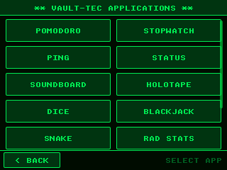<br><sub><b>apps</b><br>tile grid</sub></td>
    <td align="center" width="33%">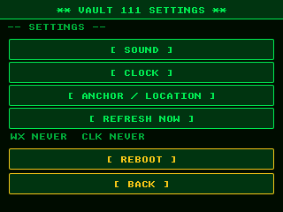<br><sub><b>settings</b><br>sound, clock, anchor…</sub></td>
    <td align="center" width="33%">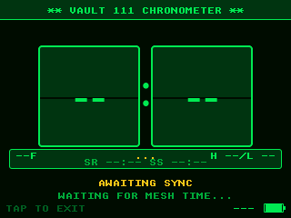<br><sub><b>chronometer</b><br>NTP + mesh time</sub></td>
  </tr>
</table>

---

## Build & flash

Install [PlatformIO Core](https://docs.platformio.org/en/latest/core/installation/),
then:

```bash
pio run -e cyd -t upload          # build + flash over USB
pio device monitor -e cyd         # serial console, 115200 baud
```

On Windows the CYD's CH340 USB-UART usually shows up as `COM##` —
`pio device list` shows all ports. For two devices, flash each by port:

```bash
pio run -e cyd -t upload --upload-port COM11
pio run -e cyd -t upload --upload-port COM12
```

Everything is configured in [`platformio.ini`](platformio.ini) (TFT_eSPI
pins, LVGL, NimBLE) — no manual `User_Setup.h` editing needed.

---

## Screenshots over USB

The CYD's panel can't be read back (its `readRect` returns black) and there's
no spare RAM for a full framebuffer, so the usual "dump the framebuffer"
trick doesn't work here. Instead the firmware ships a tiny capture hook: send
`SNAP` over serial and it forces LVGL to redraw the screen, streaming each
flushed strip back as base64 RGB565 tagged with its position. The host
reassembles a pixel-perfect PNG — no extra device memory required.

```bash
pip install pyserial pillow

# one screen (whatever's currently displayed)
python tools/snap.py docs/map.png --port COM11

# guided walkthrough of every screen (holds one connection open so the
# board isn't reset between shots)
python tools/capture.py --port COM11
python tools/capture.py --port COM11 --list   # see all screen names
```

---

## Project layout

```
src/
  main.cpp            — boot, LVGL/TFT setup, tab nav, loop, screenshot hook
  screen_*.cpp        — one file per screen (stat, inv, data, map, radio, …)
  net_espnow.cpp      — ESP-NOW mesh: heartbeats, chat, presence, gateway election
  net_manager.cpp     — net orchestration + RSSI multilateration solver
  net_wifi/websocket  — optional WiFi + cloud chat bridge
  game_proto.cpp      — host-authoritative game protocol (invites/state/actions)
  blackjack.cpp       — single-player + mesh multiplayer blackjack
  ble_grill.cpp       — NimBLE BLE temperature-probe client
  apps_state.cpp      — pomodoro / pager / quests / custom-name state (NVS)
  sound_fx, brightness, clock_sync, weather — subsystems
include/
  theme_config.h      — all branding in one place (device/vault/org names)
  pipboy_data.h        — dweller roster, quests, inventory tables
  landmarks.h          — wasteland map anchor coordinates
  net_state.h          — shared mesh/peer state structs
  lv_conf.h            — LVGL configuration
tools/
  snap.py             — pull one screenshot over USB
  capture.py          — interactive multi-screen capture walkthrough
docs/                 — README screenshots
platformio.ini        — board, pins, libs, build flags
```

Re-theming is centralized: edit [`include/theme_config.h`](include/theme_config.h)
to change the device name, vault number, or organization, and it propagates
across every screen.

---

## Acknowledgments

- Built for the **ESP32-2432S028R "Cheap Yellow Display"** — see
  [witnessmenow/ESP32-Cheap-Yellow-Display](https://github.com/witnessmenow/ESP32-Cheap-Yellow-Display)
  for the definitive pinout/reference for this board.
- **[TFT_eSPI](https://github.com/Bodmer/TFT_eSPI)**, **[LVGL](https://lvgl.io/)**,
  and **[NimBLE-Arduino](https://github.com/h2zero/NimBLE-Arduino)** do the
  heavy lifting.
- Aesthetic inspiration from the Fallout series' Pip-Boy 3000 (see the
  trademark note above — this is an unofficial fan tribute).

---

## License

MIT — see [`LICENSE`](LICENSE). Trademarked names/imagery referenced for the
aesthetic are not covered by the MIT grant and remain the property of their
owners.
